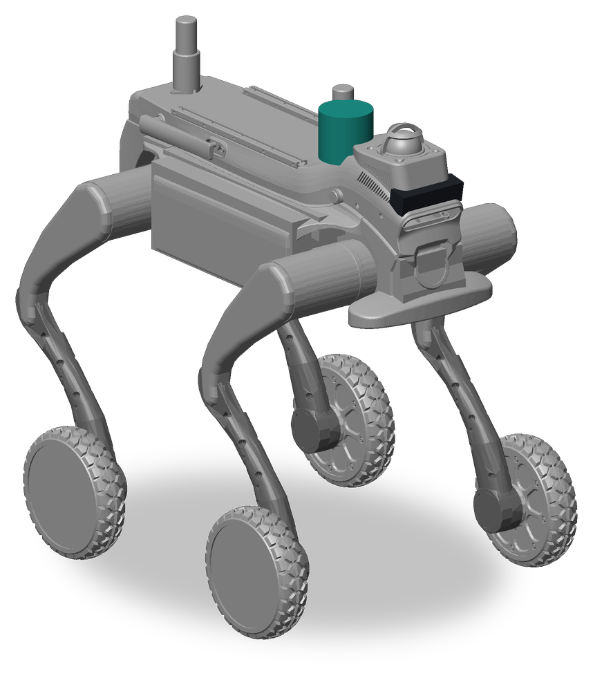
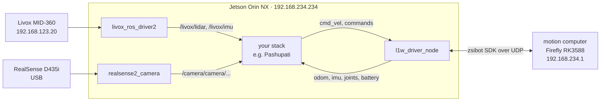

<div align="center">



# genisom_l1w_ros2

**ROS 2 Humble packages for the ZSBot Genisom L1W wheel-legged quadruped: an SDK driver for speed
commands, odometry, IMU, joints and battery, a URDF with the calibrated sensors, and one bringup
launch for the robot with its Livox MID-360 and RealSense D435i.**

[](https://github.com/DarmawanRobotics/genisom_l1w_ros2/actions/workflows/ci.yml)
[](https://docs.ros.org/en/humble/)
[](https://releases.ubuntu.com/22.04/)


[](https://github.com/DarmawanRobotics/Pashupati)
[](LICENSE)

[Features](#features) · [System](#system) · [Install](#install) · [Usage](#usage) ·
[Interfaces](#interfaces) · [Pashupati](#pashupati) · [Develop](#develop)

</div>

---

Use it as a git submodule, or a clone, inside your own workspace. The packages follow a
robot-agnostic interface contract: an application stack such as
[Pashupati](https://github.com/DarmawanRobotics/Pashupati) drives the L1W exactly as it drives any
other robot dog, through `cmd_vel`, `odom` and one Trigger service per robot command.

## Features

**Driver** (`l1w_driver`)
- Talks to the robot's motion computer over UDP through the zsibot SDK (`genisom_L1_sdk`), as
  `ROLE_SDK`. Prebuilt SDK libraries for aarch64 (the Jetson) and x86_64.
- Turns `cmd_vel` into joystick values on the channels the L1W really uses, scaled by
  `stick_max_*`. Without a new command for `cmd_timeout` the sticks go back to zero.
- Publishes IMU, odometry and joint states at 50 Hz, motor temperatures, and battery and
  diagnostics at 1 Hz.
- Every robot command is its own `std_srvs/Trigger` service: stand up, sit down, gaits, speed
  gears, emergency stop, control right.
- Takes motion control from the vendor remote when it connects. The remote can take it back at
  any time, and `sdk_control_right` returns it to the driver.

**Description** (`l1w_description`)
- xacro URDF from the SolidWorks export: 16 joints (abad, hip, knee, wheel per leg) with meshes.
- Livox MID-360, RealSense D435i and front camera frames from the robot's calibration.
- `check_frames.py` plots the sensor frames over the meshes, to check a calibration.

**Bringup** (`l1w_bringup`)
- One launch for the driver, the description, the Livox MID-360 and the RealSense D435i.
- The camera node respawns when the camera drops out. Color only, 640 × 480 at 15 fps.

## System



| Part | Address |
|---|---|
| Jetson Orin NX, runs these packages | `192.168.234.234` on the robot network |
| Motion computer (Firefly RK3588) | `192.168.234.1`, UDP `8081` (commands) and `8080` (state) |
| Livox MID-360 | `192.168.123.20`; the Jetson is `192.168.123.19` on that cable |
| RealSense D435i | USB, librealsense's libusb backend |

## Packages

| Package | Holds |
|---|---|
| [`l1w_driver`](l1w_driver) | `l1w_driver_node`, the bridge to the zsibot SDK, and `srv/SetWifi` |
| [`l1w_description`](l1w_description) | xacro URDF (body, Livox MID-360, RealSense D435i, front camera), meshes, RViz view, `check_frames.py` |
| [`l1w_bringup`](l1w_bringup) | `bringup.launch.py`, the Livox and RealSense settings |

`livox_ros_driver2` and `realsense2_camera` are not vendored here. They live in the parent
workspace (the RealSense driver from apt), so every robot package there shares one copy of each.

## Install

Ubuntu 22.04 with ROS 2 Humble (JetPack 6 on the Jetson).

**1. zsibot SDK.** Headers go to `/usr/local/include/zsibot_sdk`, `libzsibot.a` to
`/usr/local/lib`:

```bash
script/setup.sh install   # clone, build and install genisom_L1_sdk
script/setup.sh check     # installed? robot reachable?
```

For another prefix: `ZSIBOT_SDK_ROOT=<prefix> script/setup.sh install`, then
`colcon build --cmake-args -DZSIBOT_SDK_ROOT=<prefix>`.

**2. Workspace.** `livox_ros_driver2` (with Livox-SDK2) must be in the workspace for the bringup:

```bash
cd <your_ws>/src
git submodule add https://github.com/DarmawanRobotics/genisom_l1w_ros2.git   # or git clone
cd .. && rosdep install --from-paths src --ignore-src -y --skip-keys livox_ros_driver2
colcon build --packages-up-to l1w_bringup
```

## Usage

```bash
# the whole robot: driver, URDF, Livox, RealSense
ros2 launch l1w_bringup bringup.launch.py
ros2 launch l1w_bringup bringup.launch.py use_camera:=false lidar_xfer_format:=0

# driver and robot_state_publisher only
ros2 launch l1w_driver l1w_driver.launch.py namespace:=l1w robot_ip:=192.168.234.1

# the URDF in RViz, no robot
ros2 launch l1w_description display.launch.py

# sensor frames against the meshes: PNG and a distance table
ros2 run l1w_description check_frames.py --out /tmp/l1w_frames.png
```

Try it in an open area, with the vendor remote in reach:

```bash
ros2 service call /l1w/stand_up std_srvs/srv/Trigger
ros2 topic pub -r 20 /l1w/cmd_vel geometry_msgs/msg/Twist "{linear: {x: 0.1}}"   # Ctrl-C: stops
ros2 service call /l1w/sit_down std_srvs/srv/Trigger
```

| `bringup.launch.py` argument | Default | |
|---|---|---|
| `namespace` | `l1w` | namespace of the driver's topics and services |
| `robot_ip` | `192.168.234.1` | motion computer |
| `use_base`, `use_lidar`, `use_camera` | `true` | start the driver, the Livox, the RealSense |
| `lidar_xfer_format` | `1` | `1` Livox CustomMsg (FAST-LIO), `0` PointCloud2 |
| `lidar_config`, `camera_config` | `config/MID360_config.json`, `config/realsense_params.yaml` | sensor settings |

## Interfaces

**Interface contract.** Every `<robot>_bringup` exposes the same names, so the application stack
stays robot-agnostic:

| | Topics | Frame |
|---|---|---|
| base | `<ns>/cmd_vel`, `<ns>/odom`, `<ns>/imu`, `<ns>/joint_states`, `<ns>/battery` | `base_link` |
| lidar | `/livox/lidar`, `/livox/imu` | `livox_frame` |
| camera | `/camera/camera/...` | `camera_link` (TF from the URDF) |

<details>
<summary><b>l1w_driver_node: topics and services</b></summary>

Relative to the namespace (default `l1w`).

| Name | Type | Notes |
|---|---|---|
| `cmd_vel` (sub) | `geometry_msgs/Twist` | scaled to joystick values; zero after `cmd_timeout` |
| `imu`, `imu/rpy` | `sensor_msgs/Imu`, `geometry_msgs/Vector3Stamped` | 50 Hz |
| `odom`, `odom/world_velocity` | `nav_msgs/Odometry`, `geometry_msgs/Vector3Stamped` | SDK odometry, no TF |
| `joint_states` | `sensor_msgs/JointState` | 16 joints, names match the URDF |
| `motor_temperature` | `std_msgs/Float32MultiArray` | 16 motors |
| `battery` | `sensor_msgs/BatteryState` | 1 Hz |
| `diagnostics` | `diagnostic_msgs/DiagnosticArray` | modes, versions, faults, Wi-Fi |
| `<command>` (srv) | `std_srvs/Trigger` | `stand_up`, `sit_down`, `move_mode`, `balance_stand_mode`, `lock_mode`, `emergency_stop`, `slow_speed`, `normal_speed`, `fast_speed`, `crawl_forward`, `climbing_high_platform`, `hand_stand`, `unload_squat`, `enter_lab_mode`, `exit_lab_mode`, `enter_entertainment_mode`, `exit_entertainment_mode`, `*_control_right` |
| `set_wifi` (srv) | `l1w_driver/srv/SetWifi` | the result shows in `diagnostics` |

</details>

<details>
<summary><b>l1w_driver_node: parameters</b> (<a href="l1w_driver/config/l1w_driver.yaml">l1w_driver.yaml</a>)</summary>

| Parameter | Default | Meaning |
|---|---|---|
| `robot_ip` | `192.168.234.1` | motion computer |
| `send_port`, `recv_port` | `8081`, `8080` | SDK ports: commands to the robot, state from it |
| `stick_max_vx`, `stick_max_vy`, `stick_max_wz` | `1.0`, `0.5`, `1.5` | m/s and rad/s that map to a full stick |
| `stick_yaw_axis`, `stick_lateral_axis` | `2`, `1` | joystick channels of turning and strafing (the SDK documentation has them the other way round) |
| `stick_invert_yaw`, `stick_invert_lateral` | `false` | true when the robot turns or strafes the wrong way |
| `cmd_timeout` | `0.5` | s without `cmd_vel` before the sticks return to zero |
| `auto_control_right` | `true` | request SDK control on connect until the robot confirms it |
| `control_right_retry` | `1.0` | s between those requests |
| `odom_frame`, `base_frame` | `odom`, `base_link` | frames of the odometry message |
| `control_frequency` | `50` | Hz, joystick updates to the robot |
| `fast_state_rate`, `slow_state_rate` | `50`, `1` | Hz: IMU, odometry and joints; battery and diagnostics |
| `joint_names` | 16 names | SDK order [LF, RF, LR, RR] × [abad, hip, knee, foot], as in the URDF |

</details>

**Control right.** The driver runs as `ROLE_SDK`. The robot streams its state to any client, but
ignores commands and `cmd_vel` until it reports `function_mode=sdk` (see `diagnostics`). With
`auto_control_right` the driver requests control on connect and retries until the robot confirms,
then stops asking, so the vendor remote can still take over. `sdk_control_right` takes control
back. Commands other than `emergency_stop` and `*_control_right` are refused while the driver
does not hold control.

The SDK accepts one control connection only: never run two nodes that create a `ZsibotExecutor`.
Until the motion computer answers, the driver waits at start and the SDK logs
`model is empty, please wait..`; its topics and services appear once the robot is there.

## Pashupati

Clone into `src/xtras/robots/` of [Pashupati](https://github.com/DarmawanRobotics/Pashupati),
then set in `/etc/pashupati/pashupati.env`:

```bash
ROBOT_BRINGUP=l1w_bringup
ROBOT_NS=l1w
ROBOT_IP=192.168.234.1
ROBOT_SETUP=/home/robot/dev/Pashupati/src/xtras/robots/genisom_l1w_ros2/script/setup.sh
# the vendor autostart runs its own Livox driver and motion stack; quoted, it has spaces
ROBOT_PRESTART="/usr/local/bin/robot-launch stop driver-livox forward"
```

and the robot part of `/etc/pashupati/site.yaml`:

```yaml
control_mux_node:
  ros__parameters:
    field.front: 0.40
    field.rear: 0.40
    field.half_width: 0.28
    field.max_decel: 0.6          # measure on the site's floor
    field.reaction_time: 0.25
    max_vx: 1.0
    max_vy: 0.5
    max_wz: 1.5

path_follower_node:
  ros__parameters:
    holonomic: true

lidar_sector_node:
  ros__parameters:
    self_filter_x_min: -0.40
    self_filter_x_max: 0.40
    self_filter_y_min: -0.28
    self_filter_y_max: 0.28

teleop_udp_node:
  ros__parameters:
    token: "<secret>"             # the same in the handheld app
    # the handheld's action menu, in this order
    robot_commands: [stand_up, sit_down, balance_stand_mode, move_mode, lock_mode, slow_speed,
                     normal_speed, fast_speed, sdk_control_right, emergency_stop]
```

- `script/setup.sh install robot` (Pashupati) runs this repository's `script/setup.sh` to install
  the SDK.
- The vendor stack talks `rmw_zenoh` on its own domain; Pashupati stays on `rmw_fastrtps_cpp`,
  domain 0. In a shell, `source ~/dev/Pashupati/script/env.sh` before any `ros2` command.
- The vendor remote can take control back at any time; **Take control** in the handheld's action
  menu (`sdk_control_right`) hands it to the SDK again.
- The RealSense runs through librealsense's libusb backend: the kernel `uvcvideo` module must not
  bind it as well (Pashupati's `script/setup.sh install realsense` blacklists it on the Jetson).
- Operating and tuning the robot with Pashupati: the
  [User Manual](https://github.com/DarmawanRobotics/Pashupati/blob/main/docs/Pashupati-User-Manual.pdf)
  and the [Tuning Guide](https://github.com/DarmawanRobotics/Pashupati/blob/main/docs/Pashupati-Tuning-Guide.pdf)
  (body size, braking, stick channels and speed scaling of the L1W).

## Develop

CI ([ci.yml](.github/workflows/ci.yml)) runs on every push and pull request:
- builds the three packages with the zsibot SDK in ROS 2 Humble, on x86_64 and on aarch64 like
  the Jetson;
- runs `colcon test`: the ament linters of `l1w_driver` (uncrustify, flake8, pep257, lint_cmake,
  xmllint);
- expands the URDF with several argument sets and checks it with `check_urdf`, and parses every
  launch file;
- starts the driver with its parameter file (without a robot it then waits for one);
- runs shellcheck on `script/`, flake8 on every Python file, and parses the XML, YAML and JSON
  files.

Work happens on `dev`; `main` follows it. Commits follow
[Conventional Commits](https://www.conventionalcommits.org): `feat(l1w_driver): ...`,
`fix(l1w_bringup): ...`. Format C++ with `ament_uncrustify --reformat l1w_driver`.

The picture at the top is rendered from the URDF and its meshes.

## License

[Apache License 2.0](LICENSE)
